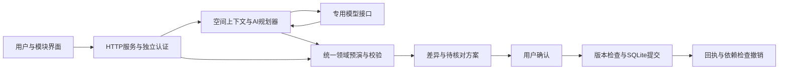

# 创宇宙技术方案草案 v1

内部准备稿，2026-09-30。不是最终参赛PDF；不包含学校、成员姓名或账号。真实模型、用户试用及独立留出结果尚未形成，相关段落必须在实测后填写。此前冻结版本的工程证据与本轮新增功能分开记录。

## 问题与范围

目标用户需要根据学习或个人项目变化重新组织工作空间。创宇宙允许用户组合文本、列表、看板、日历与资料模块，并让AI伙伴根据当前对象、选中目标和显式偏好提出跨模块修改方案。首版是独立本地单人实例，多空间共用一套对象规则；不包含云端协作、任意脚本执行、插件市场或自动读取网页。

待验证的价值假设：在需要同时修改结构、布局和记录的任务中，可核对的AI方案有机会减少手动步骤。当前没有效率提升、真实成功率或普遍用户需求的结论。

## 架构与关键机制

- **共享对象模型。** Workspace包含页面、组件、集合与资料；记录存于Collection，列表/看板/日历绑定同一集合。字段和选项使用稳定ID，改显示名称不切断记录与视图关系。[领域实现](../src/domain.mjs)、[动作目录](../src/domain-catalog.mjs)。
- **模型仅规划。** 上下文包含当前空间实际ID、选中组件、允许读取的资料、偏好和可信时钟；不包含账号或Key。模型生成结构化方案，程序限制最多5个步骤与60个动作，检查目标、引用、字段、布局和空间范围。临时引用由领域层解析，新ID由程序分配。[规划器](../src/ai-planner.mjs)。
- **核对后提交。** 预演不修改保存状态。服务器保存方案，确认时再检查全局状态版本；同请求重试返回既有回执。SQLite事务保存状态与回执，失败不留下部分提交。[HTTP流程](../src/server.mjs)、[持久化实现](../src/store.mjs)。
- **可解释的恢复。** 撤销比较被修改字段，保留后续无关编辑；同字段冲突或后加引用会拒绝整次撤销。归档视图不删除底层记录。模板默认只导出结构，导入重建ID及内部引用。[领域测试](../tests/domain.test.mjs)。
- **事实来源。** 记录值需逐字段说明依据。资料引用检查asset、hash和逐字引文，用户明确要求可引用本轮原话。引文存在不代表事实语义正确；最终需人工复核。建议日期与原文事实不能混写。[规划器](../src/ai-planner.mjs)、[评分器](../evaluation/platform-scoring.mjs)。
- **独立运行。** 专用产品标识、Cookie、账号、SQLite及运行目录；禁止通过路径或链接共享其他项目可写数据。模型配置显式提供，传输错误脱敏，费用未知时保留null。[运行隔离](../src/runtime.mjs)、[模型传输](../src/deepseek-provider.mjs)、[运行说明](../README.md)。

差异化主张目前限定为“可组合对象＋统一校验和恢复＋人核对的跨模块修改”。尚未完成竞品与真实任务比较，不能写成行业首创或优于所有工作台。

## 当前证据与边界

| 内容 | 可陈述事实 | 不能据此推导 |
| --- | --- | --- |
| 冻结版本工程测试 | 2026-09-30记录97/97通过，含领域、规划、传输、HTTP、隔离及评测工具 | 真实AI正确率、用户满意度 |
| 浏览器流程 | 13条主流程及3条恢复流程通过，模型回复为工程注入 | 真实模型端到端可靠性、实体手机验收 |
| 源码复现 | 同机全新解压目录：40文件校验、97/97测试、空白实例启动通过 | 第二设备或所有环境均兼容 |
| 24开发题 | 普通20、澄清2、恢复2离线回放机械通过；金标复核pending | 正式模型成绩；16题留出已完成 |

原始证据位置及限制见[任务记录](../TASKS.md)；旧报告不因后续代码变化自动成为新功能验收。确认前完整差异/引文展示、偏好闭环、完整备份恢复、连接测试：**本轮实施中，待最新验收**，最终方案必须替换为对应版本的真实结果。

## 验证计划与待填结果

按[平台试用协议](../evaluation/平台评测设计与试用记录模板_v1.md)，由未调优人员复核24开发题并独立编写16留出题。真人比较手动、同模型聊天建议后手动、完整AI三条件，轮换顺序与等价任务变体，计时包含等待、阅读、确认及纠错。[平台运行器](../evaluation/run-platform.mjs)记录机械约束和失败；[聊天输入生成器](../evaluation/build-chat-advice-inputs.mjs)只准备B条件合成输入。

| 待填字段 | 当前状态 |
| --- | --- |
| 专用模型、参数、prompt与代码冻结版本、预算 | 待实际配置与确认 |
| 开发/留出逐题成功、错误写入、澄清、来源语义 | 待真实调用和独立复核 |
| 参与者、顺序、耗时、纠错、反馈及同意记录 | 尚无真人记录 |
| 实际usage、价格快照、失败/重试费用 | 尚无实测，费用null |
| 实际失败案例及修复复测 | 待实测；不得只保留成功案例 |

## 贡献与提交准备

本项目使用AI辅助开发。模型HTTP传输机制从既有工程独立迁移，通用对象平台和界面在当前项目建设；逐项来源见[SOURCES](../SOURCES.md)，参赛者实际贡献需按[核对清单](贡献核对清单_草案_v1.md)确认。将本文制作PDF前，需要补真实结果、统一演示与代码版本、核对当届规则及匿名要求；本文不是已提交成果。
