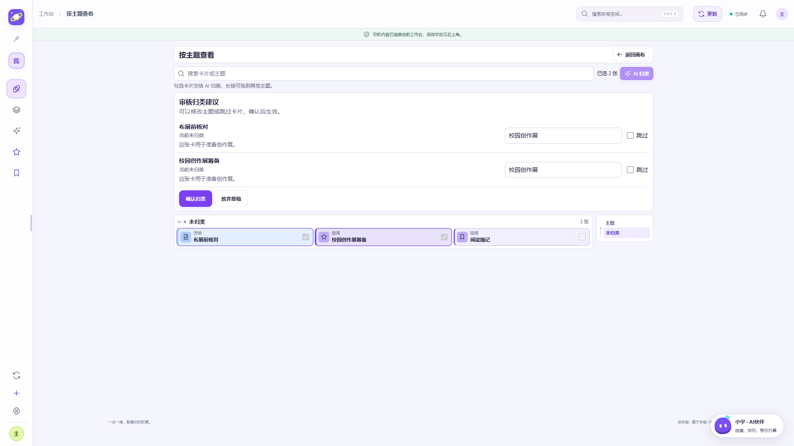
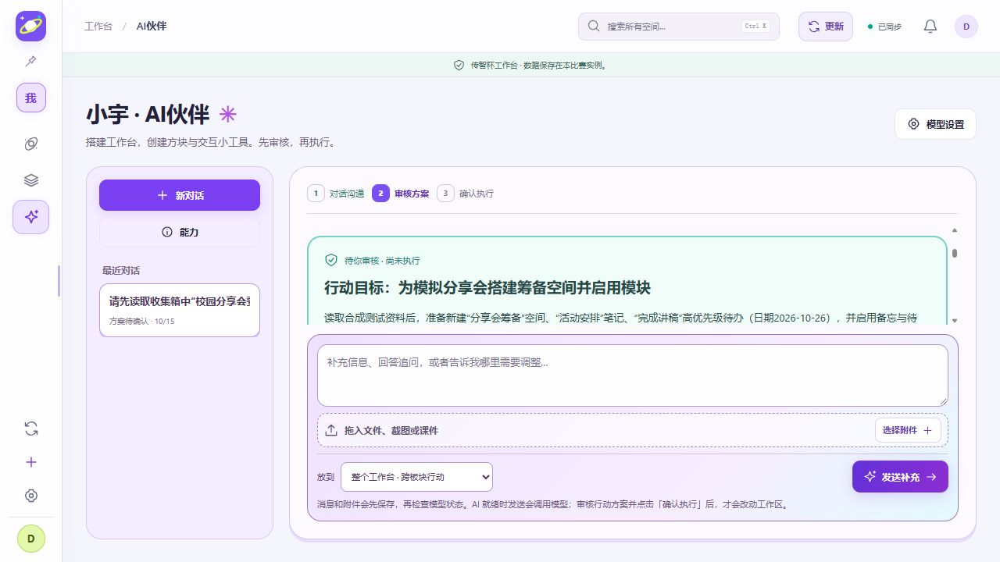
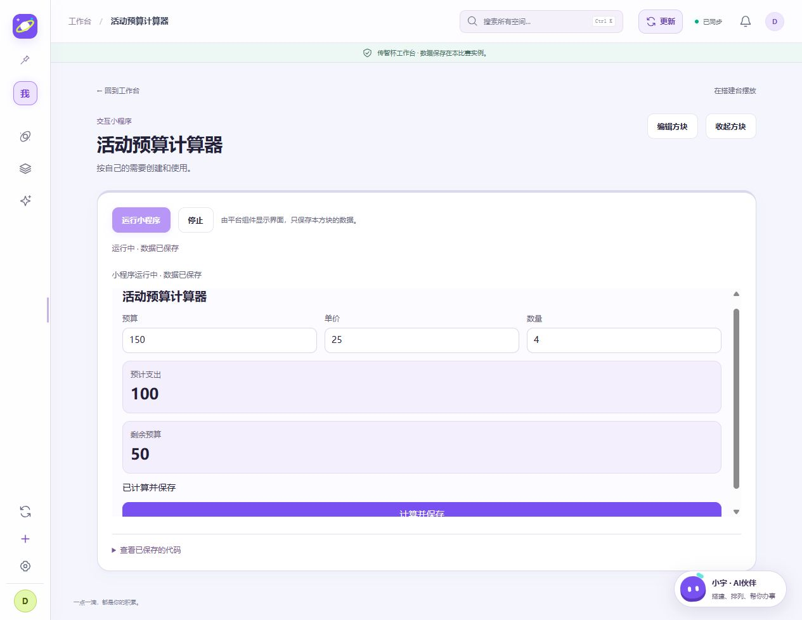
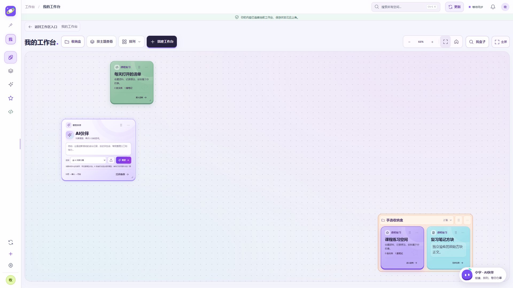

# 创宇宙
## 从自然语言意图到可审核的工作台操作

第九届传智杯全国大学生数智创新与 AI 应用大赛

AI 创新应用挑战赛 · 技术文档 · 正式版 v2 · 2026-11-16

### 摘要

创宇宙将课程、事项、笔记和自定义工具放入同一个可搭建的工作台。模块与空间可以在自由画布上组织。内容增多后，用户可以选择卡片，让 AI 提出主题建议，再人工修改、确认或撤销。日常事务也可以由 AI 协助查询资料和草拟方案，经审核后写入支持的业务。

本文说明项目怎样限制模型处理的上下文，怎样隔离建议与写入，怎样保留可核查的开发过程，以及评审怎样在自己的电脑复现。正式版应用源码固定为 `68b6af9fbb03c61224eebd748fc03d77bbd5ad04`。

:::overview

### 建议阅读顺序

第 01 至 03 节说明架构、开发意图和归类协议。第 04 至 07 节说明受控执行与实际开发过程。第 08 至 11 节给出加载改进、验证、复现步骤和证据位置。

<!-- PAGE -->
# 01 架构与数据约束

:::architecture

| 组成 | 实现位置 | 职责 |
| --- | --- | --- |
| 页面与画布 | `yuzhou/frontend/src/` | 搭建、空间与方块、AI 审核、主题目录和收纳交互 |
| 接口和存储 | `yuzhou/backend/server.mjs`、`store.mjs` | 认证会话、工作区版本校验、事务与 SQLite 持久化 |
| 主题建议 | `workspace-topics-model.js`、`workspace-topics.mjs` | 定义可选卡片、校验模型建议、确认和撤销 |
| 画布收纳 | `canvas-topic-boxes.js` | 盒子坐标、折叠、成员及拖放 |
| 扩展能力 | `miniapp-*.js`、`extractor.mjs` | 受控交互能力及支持格式的文本提取 |

浏览器使用按账号隔离的 IndexedDB 保存缓存及审核草稿。SQLite 维护工作区版本，实际确认时以最新业务状态校验和保存。主题归属和回执记录在 `workspaceTopics`，收纳盒坐标、折叠与成员记录在 `canvas.topicBoxes`。盒子移动时更新成员的显示位置，原卡片坐标保留。拖出时以松手落点放回画布。

参赛包使用本机回环地址与独立运行目录。模型连接和附件解析按需要配置，基础保存和重启复现可独立完成。

<!-- PAGE -->
# 02 意图控制与提示设计

### 开发阶段怎样明确任务

开发指令围绕四个问题展开：当前哪个操作存在问题，使用者应该看到什么变化，哪些已有数据及交互需要保留，如何证明修订实现了目标。作者先指出真实使用场景和接受条件，Codex 再定位相关模块，提出修改，运行检查并记录结果。需要保护的主空间、子空间、其他模块和业务数据一并写进范围。

| 输入内容 | 约束和检查方式 |
| --- | --- |
| 目标与范围 | 具体到入口、对象和动作。例如从方块库直接拖入，实际画布需要更新。 |
| 原有行为 | 移动、缩放、双击访问继续有效，业务内容和旧坐标按实际操作保存。 |
| 修改反馈 | 在运行结果里观察失败或交互回退，带着具体页面、报错或状态重新指导修改。 |
| 检查证据 | 将实际对话、原始 Git 差异和浏览器或工程结果对应。 |

### 产品怎样约束模型任务

系统根据操作类型提供允许的输入和结构。归类只提供选中卡片的标题、类型和简介。业务行动先通过受支持的查询取得当前记录，再由模型拟定方案。模型响应交给应用检查，审核单给出用户可以核对的对象和变化。确认时重新检查目标对象和工作区状态。

开发对话和产品内模型调用分别保存证据。前者说明一个功能怎样制作与修正，后者说明某个已实现流程在指定场景中的表现。

<!-- PAGE -->
# 03 主题建议、确认与撤销

用户在「按主题查看」勾选卡片。服务按当前可见工作区解析所选编号，再向模型提供标题、类型和简介。提示明确把卡片内容作为整理材料，要求返回含编号、候选主题及理由的 JSON。线索不足时主题可为空，字段长度有上限。服务校验数量、重复或未知编号、额外字段及类型。

| 阶段 | 实现约束 | 用户所见 |
| --- | --- | --- |
| 建议 | 编号必须来自输入，每项恰好一次 | 候选主题与理由，审核草稿可以回看 |
| 审核 | 只允许修改所选范围，可跳过单个条目 | 用户调整后看到待保存的项目 |
| 确认 | 比对最新卡片和生成时的快照，保存批次与回执 | 信息已变更时可重新选择。同批同内容重试可取回原回执。 |
| 撤销 | 核对当前归类仍对应这次操作 | 恢复可恢复的项目，保留后续的手动调整 |

AI 伙伴是操作入口，主题归类的可选对象为工作台业务卡片。建议、确认和撤销只影响主题归属及操作回执，收纳成员与业务记录仍由原来的模块管理。



<!-- PAGE -->
# 04 查询、修订与受控业务行动

:::workflow

工作台的 AI 伙伴可先查询允许的应用对象，再对已有资料提出下一步行动，如拟定准备清单或根据日期新增待办。提示规定查询的对象、行动格式及允许使用的字段，应用分别解析查询与动作。校验通过的候选方案先进入审核，用户还可以给出新日期或内容，再查看更新后的方案。

DEV-027 中，合成工作区先读到现有筹备资料，讲稿截止日期经过多轮修订，从 25 日改为 26 日。确认后创建了空间、笔记和关联待办，日历显示同一条待办。合成环境进一步检查了刷新、撤销和撤销后刷新，并核对保护记录。最后一次查询和方案补验记录了自己的测试范围。



<!-- PAGE -->
# 05 自定义扩展与运行权限

:::miniapp

配置型方块使用已有交互和字段，适合便签、清单、网址、进度及计数。代码型小程序可以添加项目需要的计算与交互，先经过审核保存，再由用户手动启动。运行时使用注入接口读写所属方块的数据，由可信页面渲染支持的组件。配置、已有数据、临时预览与运行状态分别处理。

| 输入或动作 | 核查点 |
| --- | --- |
| 空预算、负单价、零数量 | 显示错误，保护前一次有效结果 |
| 关闭后手动重开 | 检查可否读出上次保存值 |
| 经审核增加使用率显示 | 继续使用原数据，超预算数值按实际计算 |
| 撤销功能增强 | 恢复旧配置并保留已经使用过的数据 |



<!-- PAGE -->
# 06 实际开发过程一与二
## 从需求反馈到可核对的代码修改

### 一、让搭建操作直接可用

作者希望把个人定制工作台变成更多人可以自行搭建的工具，随后实际反馈模块摆放抽象、同屏导航不足，以及恢复中出现的拖入回退。Codex 将模块库与画布放在同一界面，把落点写入实际工作台。提交 `154e54e` 恢复默认拖入入口，后续 `964a7c3` 则调整卡片内容随宽高变化的方式。评审可对照开发原文中的问题、对应代码差异，以及拖入、双击和刷新检查。

原文摘录： 「保留其他的更新，这一点改回去。」这段要求前文说明要恢复从左侧拖入，后文要求双击方块可打开并编辑。

专业说明：`evidence/prompt-chains/01-可视化搭建平台.md`。原始公开文本见 `raw/chain-01.md#L6019`。

### 二、核对 AI 行动和撤销

作者要求先验证完整 AI 使用流程，保留其他功能，并在合成工作区进行。真实联调出现旧查询结果被拦截后重试未更新、合法空查询被拒绝，以及浏览空间生成的自动布局导致撤销残留的问题。Codex 调整重试生命周期、协议兼容和自动布局辨识，再检查日期修订、确认、关联、刷新和撤销。代表性修订涉及 `6fe0529`、`02dad36`、`c67496d`。缺陷由实际联调发现，作者提供了目标、范围与验收要求。

原文摘录： 「先把完整的AI使用流程跑通，保留其他更新，只修改这个比赛的副本，继续分阶段提交Git。」

专业说明：`evidence/prompt-chains/02-AI业务闭环.md`。原始公开文本见 `raw/chain-02.md#L13020`。

<!-- PAGE -->
# 07 实际开发过程三
## 用真实失败修订小程序接口约束

作者要求兼顾配置型方块和代码型小程序，并实际走完生成、审核、手动运行的流程。首次生成的预算界面保存成功，运行时却报错。生成代码的局部变量遮蔽了注入的 `app` 接口，另有非法输入处理不完整的问题。

随后在提示中明确注入接口的使用方式，加入先检查输入再显式保存的例子。宿主也修正了错误或停止后的重试入口，以及撤销时对业务状态的保护。修订版再次走完预算输入、计算、保存、停启、增强及撤销。预算 150、单价 25、数量 4 时，支出 100、余额 50。功能增强时复核既有数据继续使用，并通过超预算、零预算样本检查边界提示。

原文摘录： 「接下来把AI创建自定义方块和小程序的流程也跑通，保留其他更新，只修改比赛副本，继续分阶段提交Git。」

专业说明：`evidence/prompt-chains/03-自定义方块与小程序.md`。原始公开文本见 `raw/chain-03.md#L14715`。实际运行记录：`evidence/dev/DEV-028.md`。

### 三条链如何复查

三条主题链共 104 条公开文本、46 条真实提交索引和 10 份关键代码差异。归档将原始文本与专业说明分别保存，覆盖指定主题的公开文本，部分原始图片和工具执行正文未纳入。可按顺序读问题、原句、修改差异与结果，关联提交可在完整 Git 历史中核对。

<!-- PAGE -->
# 08 加载改进与交互观察

| 遇到的问题 | 实现与检查 |
| --- | --- |
| 首次静态资源下载较大 | JS/CSS 按浏览器支持选择 Brotli 或 gzip，后续请求按内容和编码校验 ETag。 |
| 首屏过早加载其他页面能力 | 课程、英语与备份等功能按需加载，提前请求必要的公共模块。 |
| 首次会话和登录等待缺少反馈 | 较慢时显示等待状态。会话检查超时可重试，初始读取失败时在条件允许的情况下恢复本机缓存。 |
| 小窗口中难以定位盒子 | 卡片主题在画布内回显，收纳盒可按名称定位，展开后显示手动选择的成员。 |

预加载的历史阶段以同机合成工作区模拟 60 毫秒延迟、约 12 Mbps 下载，比较 `57b3e4f` 和 `22ea789` 的 12 对配对样本。首开差值中位数提前 90.2 毫秒，最后一个 JS 完成提前 98.3 毫秒。当前正式版本身的本机启动检查核对了 Brotli 响应及 ETag 304。浏览器另核对 390 像素下的主题操作与收纳定位。



<!-- PAGE -->
# 09 验证结果与适用范围

| 验证对象 | 版本与环境 | 实际结果 |
| --- | --- | --- |
| 正式源码工程回归 | `68b6af9`，Node.js 25.7 | 929 项，926 通过、0 失败、3 跳过。跳过两项可选的 Python 文档解析检查，以及移动浏览器原生备份桥接。 |
| 主题与收纳交互 | `cd8771d`，Edge 157，独立 SQLite，模拟模型 | 6 组归类、9 组收纳通过。含双窗口冲突、断线回执、保护后续编辑、390 像素窄屏，以及拖入拖出、折叠刷新等。 |
| AI 行动与受控小程序 | DEV-027 与 DEV-028 的合成工作区 | DeepSeek 实际调用，保留模型首轮失败、修订及复核。验证按各自阶段记录。 |
| 主题归类模型样本 | `ba456e0`，合成卡片 | 1 次 DeepSeek 请求，360 token。核对了建议、人工调整、确认与撤销。 |

正式版相对浏览器用例的源码阶段补充本机模型配置提示，并重新运行工程回归。测试主体没有使用私人工作区。原始 TAP 报告与界面截图可供检查。

本次验收覆盖本机复现、指定环境和表中操作。真实模型样本用于展示特定案例的运行结果，整体成功率、一般用户节省时间、公网部署和全设备兼容需其他证据。

<!-- PAGE -->
# 10 十分钟复现指南

### 0 至 3 分钟：配置环境与校验文件

装好 Node.js 22.13 或以上，将配套 ZIP 解压到普通可写目录。进入解压后的包根目录，检查版本、源码清单和启动条件。

```powershell
node --version
node tools/verify-source.mjs
node tools/start.mjs --check
```

### 3 至 7 分钟：启动与保存

运行 `node tools/start.mjs`，浏览器访问 `http://127.0.0.1:4397/`。首次使用按 README 读取当前副本初始化口令、创建账号，即可进入搭建台。新增一个待办或便签，保存后刷新确认，再重启服务检查持久化。基础运行只依赖 Node.js 与本地浏览器。新副本的运行数据位于 `yuzhou/.cu-runtime/`。

### 7 至 10 分钟：审查归类操作

在包根目录执行 `node tools/review-demo.mjs`，按终端提示在 `http://localhost:4398/` 打开隔离演示。按界面选择示例卡片、修改模拟建议、确认并刷新，再撤销。使用独立的合成工作区能在无模型 Key 时复现这条交互。需要真实模型时，回到正常应用，在「偏好与连接」配置自己的可用模型。环境变量模板、可选解析依赖和后续步骤见源码包 `README.md`。

从独立目录解包实测通过 317 项完整性检查，其中 303 项为应用文件；含清单共 318 个文件。正常模式启动在 4397，隔离 Edge 经 4398 实测选卡、改建议、刷新恢复、确认、再次刷新和撤销。

以上时间是复现操作的安排。实际耗时取决于设备和初始环境。安装 Node.js、配置真实模型或下载可选附件解析依赖的时间另外计算。

<!-- PAGE -->
# 11 证据索引与开发连续性

| 核查事项 | 位置或版本 | 可阅读内容 |
| --- | --- | --- |
| 作品名称和起点 | `docs/创宇宙-项目名称与开发连续性说明-v1.md` | 「宇宙」作为创宇宙早期名称，工作台功能从同一作品持续发展。 |
| 三条原始 Prompt 链 | `evidence/prompt-chains/README.md` | 主题链、原文范围、真实提交、关键差异与测试。 |
| 首次真实行动、小程序 | `evidence/dev/DEV-027.md`、`DEV-028.md` | 合成数据、真实模型、失败、修订和验证。 |
| 正式版源码 | `68b6af9fbb03c61224eebd748fc03d77bbd5ad04` | 当前源码包业务基线，独立的源码清单可复查文件内容。 |
| 正式版工程检查 | `evidence/engineering/DEV-053-tests-2026-11-15T09-58-55-753Z.tap` | 实际 929 项清单、通过与跳过项。 |
| 当前浏览器证据 | `evidence/engineering/DEV-053-topic-review.png`、`DEV-053-topic-box.png` | 隔离浏览器的归类审核与收纳盒操作。 |

Git 原始提交保留其作者、日期与历史关系。早期发布快照的补录保存补录时间和独立记录，便于区分原始开发与后续版本整理。运行与验收从配套源码包开始，开发证据从 Prompt 链入口开始。赛道的材料要求以主办方 10039 赛道详情为准。
