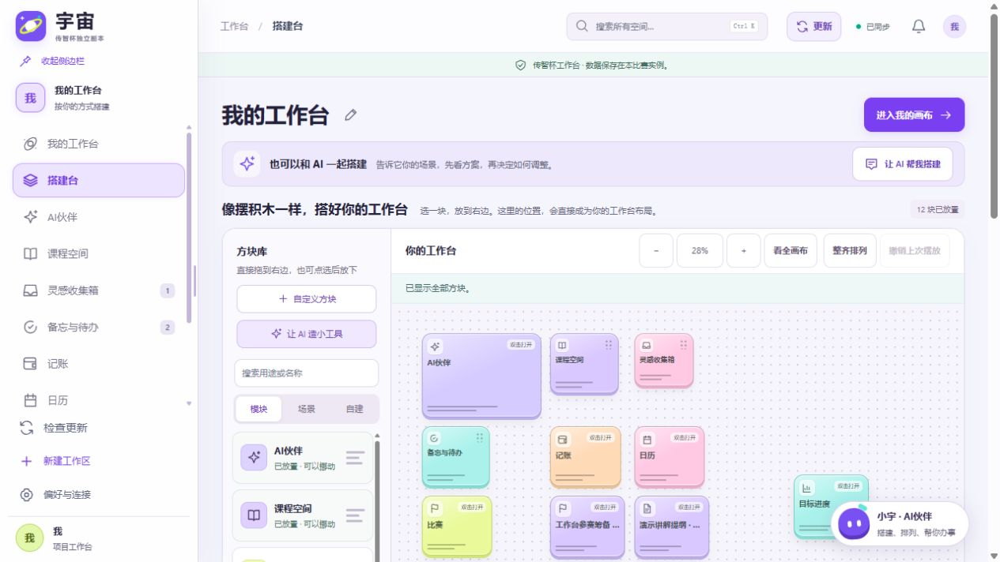
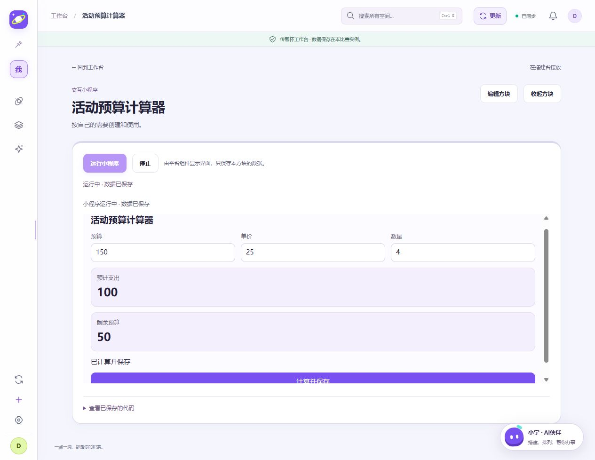

# 创宇宙
## AI 辅助开发的可组合个人工作空间

第九届传智杯全国大学生数智创新与 AI 应用大赛

AI 创新应用挑战赛 · 技术文档

版本：正式提交版 v1 / DEV-045 · 编制日期：2026-10-19

### 摘要
创宇宙面向个人信息分散、固定软件流程难以适配不同使用习惯的问题，提供模块、场景模板、自由画布及自定义方块，由使用者组合自己的工作环境。常驻 AI 伙伴“小宇”可以读取受支持的工作内容、提出调整方案，并在用户审核确认后执行；对于新增交互需求，还可生成在受控运行器内执行的小程序。

项目基于作者既有宇宙 0.15.0 的公开源码，在独立比赛副本中持续开发。比赛阶段的重点是平台化搭建、直接操作体验、结构化 AI 行动闭环和双层方块创建。本报告通过三条真实开发链说明需求如何转化为约束、偏离如何被发现，以及代码、提示与验证如何共同演进。

本次提交ZIP解压后，在 Node 22.23.3 的干净目录下完成 862 项检查，其中 861 项通过、0 失败、1 项可选跳过。真实模型已完成指定合成业务场景和小程序场景的验证，包含失败与修订。本文不以工程检查数代替用户效果或模型成功率。[E01-E06]

:::overview

### 版本与阅读范围
应用基线：9c567d7d3c3a。正式包在该基线上统一名称、清理机器信息并禁用历史测试入口；转换清单及前后哈希随包提供，活动应用不改。本报告是依据既有证据形成的专业说明，不是原始 Prompt；原始文本、历史提交及失败报告单独保留。截图来自相应历史阶段的合成验证环境。

阅读路线：问题与价值（第2页）→架构与意图控制（第3-5页）→三条开发链（第6-8页）→体验、验证与复现（第9-11页）→限制与证据索引（第12-13页）。
<!-- PAGE -->
# 01 问题定义与应用价值

### 从固定功能集合转向用户可组合的平台
原工作台围绕作者的学习和日常习惯组织功能。当用途转向项目推进、资料整理或活动筹备时，固定首页及导航会增加无关信息，也限制用户自行组织内容。用户因此提出沙盒式产品方向：平台提供物品、规则和指引，使用者决定如何搭建，AI 持续参与调整。[E01]

| 真实需求 | 本项目的设计回应 | 可观察的验收点 |
| --- | --- | --- |
| 不同用途需要不同工作环境 | 10个内置模块、6套组合；新用户从空白开始 | 应用模板只改配置，收起模块后业务仍保留 |
| 放置方块过于抽象 | 方块库与画布同屏，支持直接拖入、撤销和双击访问 | 搭建台位置与实际首页一致 |
| 固定模板覆盖不足 | 7种自定义方块，并允许受控代码型小程序 | 生成内容可编辑，配置与运行数据分开 |
| AI建议需要落实到实际内容 | 查询、审核单、修订、确认、关联、撤销 | 确认前无业务写入，刷新后结果可查 |

### 典型使用路径
以活动筹备为例：用户先将资料放入收集箱，再让 AI 读取相关内容，建立筹备空间、笔记和截止任务。待办日期直接投影到日历，避免把同一事项维护两份。用户还可创建活动清单和预算工具，并在后续调整功能时保留已经填写的数据。学习、研究和生活管理可选用不同模块组合，不预设所有使用者都具有学生身份。

### 复用来源与比赛新增贡献
基线导入为150个公开源码文件，来源清单和哈希留存，导入提交为 ac73158。课程、课表、账本等既有业务构成可复用基础；比赛期间新增的平台配置、可视化搭建、主子空间画布、导航编排、AI闭环、自定义方块和小程序，以及存储迁移、课程课表关联、账单分类和交付复现，分别有阶段记录。[E07]

当前价值证据是功能可操作、关联可验证和开发过程可追溯。尚未进行独立用户对照试验，因此不宣称节省固定比例的时间、显著提高创作效率或已适用于所有人。既有源码与比赛新增贡献分别披露，不将基线导入描述为本届比赛期间从零编写。
<!-- PAGE -->
# 02 系统架构与职责划分

:::architecture

### 页面、模型与存储各有边界
前端以原生 JavaScript 模块组织入口、搭建台、自由画布、业务页面和 AI 审核界面。Node HTTP 服务承接鉴权、工作区状态、附件与模型接口；SQLite 保存账号、会话和应用状态。浏览器显示的方案须经过应用协议与目标对象校验，确认后由既有行动机制执行。[E08]

| 层次 | 代表文件或目录 | 设计责任 |
| --- | --- | --- |
| 工作台与画布 | frontend/src/builder.js、canvas.js、workbench-model.js | 模块配置、位置和视野分离；与真实业务入口连接 |
| AI操作与执行 | frontend/src/workspace-actions*.js | 行动预览、状态约束、执行及有边界撤销 |
| 查询与模型适配 | backend/workspace-queries.mjs、hermes.mjs、deepseek.mjs | 提供受支持上下文，组织模型交互并校验响应 |
| 持久化与访问 | backend/server.mjs、store.mjs | 正常认证、会话、CSRF校验、版本及事务保存 |
| 文件与交互扩展 | backend/extractor.mjs、extract.py；frontend/src/miniapp-*.js | 正文提取及所属方块内的受控交互 |

### 独立副本是工程前提
比赛源码、数据和测试以独立物理副本隔离。提交包默认4399，使用独立账号和运行目录；启动时核对实例身份，端口冲突时不停止未知服务。

这是一套本地网页应用架构。现有安全控制与隔离测试不等同外部安全审计；本轮交付未验证公网多用户生产部署或跨设备运维。
<!-- PAGE -->
# 03 意图控制：从自然语言到业务行动

:::workflow

### 将模糊请求转化为可核对的执行对象
模型先通过受支持的查询读取资料和现状，再返回结构化方案。提示中列明允许字段、容器标识、查询规则与行动格式；应用独立检查对象是否存在、行动是否合法以及工作区状态是否仍适用。模型 HTTP 成功并不意味着方案可接受，生成内容仍需审核。[E02、E08]

| 阶段 | 输入与输出 | 不变量 |
| --- | --- | --- |
| 查询 | 用户任务、查询协议、实际记录 | 非空查询与执行方案互斥，不把未知字段默认为合法 |
| 生成与修订 | 当前上下文、最新补充要求、完整替代方案 | 修订替换待审核版本，尚不创建业务对象 |
| 人工审核 | 对象、内容、日期、代码及预期变化 | 用户可继续修订或拒绝，不因文字回答自动执行 |
| 确认与保存 | 最新合法方案、状态校验 | 过期方案受阻后应能按新状态重试；保存失败需恢复 |
| 刷新与撤销 | 已执行记录、后续修改情况 | 只清理可识别的本次影响，保护后续编辑 |

### 精确兼容，而不是取消校验
真实验证发现合法的无查询方案可能使用省略字段、null或空数组。实现将这三种表达统一为“没有查询”，同时继续拒绝非法类型以及非空查询与行动混合。纯查询轮允许省略自然语言回复。相关变更分别见02dad36、efe9436；协议提示及结构诊断见9b88757。[E02]

### 上下文与用户数据的关系
查询能力围绕当前应用支持的对象与容器工作，资料解析结果作为任务材料，不赋予内容额外系统权限。上下文有范围与容量约束，不描述为任意规模知识库。审核单是用户作出决定的界面，不是供应商输出正确性的保证。
<!-- PAGE -->
# 04 自定义方块与受控小程序

### 两层创建满足不同复杂度
配置型方块覆盖便签、清单、网址收藏、进度、重要日期和记录表；代码型方块承载交互小程序。用户明确选择两种能力并存，模型可以组合字段和内容，也可以在平台接口范围内生成新的计算或交互逻辑。[E03]

:::miniapp

### 配置、数据和运行状态分别管理
方块配置保存标题、类型、字段或代码，私有数据保存使用过程中的输入与结果。更新代码不应无意覆盖已有数据；清单追加条目时保留原ID与完成状态。草稿预览仅作用于临时状态，取消预览后不能把试填值写入正式记录。审核确认创建与手动运行是两个不同操作。

| 控制点 | 当前实现与核验 |
| --- | --- |
| 手动执行 | 保存源码、确认方案或刷新页面不自动运行；运行需显式点击 |
| 受控交互 | 隔离运行器内的Worker执行代码，可信页面渲染受支持组件树 |
| 数据范围 | 使用注入的app接口读写所属方块数据；不直接操作其他业务对象 |
| 异常恢复 | 停止、错误及超时后恢复运行入口，忙循环具有超时终止保护 |
| 权限边界 | 未提供任意HTML、主页面DOM、网络、依赖安装或外部软件操作能力 |

### 生成质量依赖审核与反馈
首次真实生成的预算程序曾用局部变量遮蔽注入接口而报错。后续提示明确接口用法，并给出先校验输入、等待显式保存、再展示反馈的示例。另在审核中纠正成功提示遮挡计算结果、百分比被错误截断等问题。提示改进提高约束的清晰度，但不能证明所有未来生成程序都正确。[E03]

本阶段保留“生成、确认、运行、保存、更新、撤销”的独立检查，避免把语法通过或创建成功直接当作程序可用。
<!-- PAGE -->
# 05 开发链一：把搭建变成直接操作

### 人的反馈推动产品方向与交互纠偏
用户首先指出个人定制工作台不一定适合其他人，提出由每个人自行搭建的平台方向。初始配置能力完成后，用户继续指出放置抽象、缺少画布导航、拖入功能回退以及卡片只放大外框等问题。AI据此调整模型、事件处理和尺寸适配，过程保留了连续原文与真实提交。[E01]

| 迭代 | 关键判断 | 代码或证据 |
| --- | --- | --- |
| 平台化 | 新用户空白搭建，既有数据兼容，模块收起不删除业务 | DEV-004 |
| 可视化摆放 | 方块库与画布同屏，位置直接写入真实画布 | 68c569d、e34b7af |
| 视野导航 | 缩放、平移只改变视野，不误存为业务位置 | 5ebe9da、27dd733 |
| 恢复直接拖入 | 新增分类将模块藏入次级入口；恢复默认入口，保留其他更新 | 154e54e |
| 内容自适应 | 用卡片宽高调整插画、标题与统计，处理扁卡和窄卡 | 964a7c3 |



### 这条链证明了什么
人的作用体现为产品定位、实际问题反馈与验收目标；坐标换算、事务保存及事件清理由AI提出并实现。DEV-020的一个尺寸样本中，卡片从320×238变为640×560时，图形从约59.86×61.55变为130.30×133.97像素。该数据只说明指定样本的内容适配，不泛化为任意尺寸性能结果。[E01]
<!-- PAGE -->
# 06 开发链二：跑通可撤销的 AI 业务流程

### 从单次响应扩展到完整业务状态
用户确定先跑通完整AI流程，并要求保留其他更新和阶段提交。开发助手在独立合成账号中，以“校园分享会”资料验证查询、生成、修订、审核、关联、刷新和撤销。缺陷级问题主要由AI联调发现，本文不将其改写为用户逐条提出的修复指令。[E02]

### 三个实际偏差与修正
一是模型等待期间工作区变化后，旧结果被拒绝，但重试仍可能复用旧结果；6fe0529修复重试生命周期。二是合法空查询或纯查询省略回复被误拒；通过精确协议兼容修正。三是浏览新空间会自动生成子画布，撤销把它误认为人工编辑而留下空空间；c67496d区分已知自动布局与后续编辑，保留修改保护。


### 结果与证据边界
完整成功轮次是在首次发送失败、正常重试之后完成的：讲稿截止日期由25日改为26日，确认前无新增业务；确认后建立1个空间、1篇笔记和1条关联待办，日历26日展示同一任务，未重复创建独立日程。浏览、刷新、撤销及再次刷新后，无新增残留空间或孤儿画布，保护资料与原待办哈希不变。

六轮共19次真实请求、203328 token；最终源码efe9436的工程结果为785项中784通过、0失败、1项可选跳过。最终补验只复核查询与方案生成，不重复声称又完成一次全链撤销。单个合成案例不代表总体成功率。[E02]
<!-- PAGE -->
# 07 开发链三：从生成代码到可持续使用

### 首次失败成为明确的接口约束
用户要求同时具备配置型和代码型创建，随后要求跑通真实流程。DEV-028以活动清单和预算计算器验证。首次创建后运行报app.getData is not a function，原因是生成代码使用const app=this遮蔽宿主接口；非法输入分支也存在保存行为。原错误截图与真实消耗均保留。[E03]

修订分为两条：生成提示明确注入接口、输入校验和显式保存；宿主修复停止或失败后的重试入口、私有JSON字段误判及撤销残留。对模型输出的修订继续通过真实模型完成，没有用人工替换答案伪装成生成成功。



### 使用、增强与撤销的连续检查
空预算、负单价和零数量拒绝保存；停止重开可读取上次有效值。功能增强增加使用率66.7%，保留原数据；预览预算50显示真实200.0%，进度条上限100%，预算0明确无法计算。取消预览后保存值仍为150/25/4。撤销增强恢复旧配置，撤销创建保留已经使用的方块。

共9次真实请求、116584 token，包含首次失败和审核修订。源码86c03fe的全量810项中809通过、0失败、1项可选跳过；工具另16项通过，分别统计。这证明指定流程可用，不承诺任意小程序一次生成成功。[E03]
<!-- PAGE -->
# 08 交互设计与近期完善

### 在自己的场景中搭建
自由画布承载模块、空间和自定义方块，搭建台操作对应实际工作台。缩放和平移独立于业务几何，卡片内部内容随容器适配。主空间与子空间各自保存画布，层级目录和来源返回帮助用户在多个场景中切换。全局模块以共享入口出现，所属自定义方块和下级空间有明确归属。[E01、E09]

### 欢迎入口与持续流动的灵感
欢迎页由真实可用模块、空间和方块生成可点击入口，错落悬浮与紧凑布局之间连续过渡。自主漂浮、鼠标响应和单卡悬停保护用于识别与访问；后台、离屏、减少动态效果及卸载有清理机制。

梦境从已有未归档灵感中随机取样，让条目沿缓弯路径持续移动；它重现已有记录，不生成虚构经历。欢迎页氛围参考Lightspark，未复制其素材。动效服务于阅读与访问，不被当成效率提升的量化证据。

| 近期问题 | 实现与验证方向 | 阶段证据 |
| --- | --- | --- |
| 子空间缺少直接搭建入口 | 选择画布、层级目录、独立配置及来源返回 | DEV-035/036 |
| 缓存空间不足与重复同步冲突 | 账号隔离IndexedDB、事务迁移、冲突保留与恢复 | DEV-034 |
| 课表与课程资料脱节 | 稳定courseId、批量预览、课程笔记直达 | DEV-037 |
| 分类筛选与录入不直观 | 账单分类筛选/分组、原生分类选择及自定义草稿恢复 | DEV-043/044 |
| 页面留白与长标题裁切 | 紧凑边距、AI工具栏图标及赛事标题自然换行 | DEV-038/040 |

### 验证边界
历史阶段有合成浏览器及指定视口检查，但并非所有页面、数据状态、浏览器缩放手势和真实设备均已验收。DEV-044当轮的窄屏覆盖未实际生效，不把它计为通过。当前交付采用无私人内容的新账号，已有真实资料不会自动出现在评委环境中。
<!-- PAGE -->
# 09 工程验证与真实模型证据

### 本次交付的直接验证
2026-10-19从正式ZIP解压到本机全新目录，未继承作者账号、数据和模型配置。以正常认证API验证创建账号、登录、保存、读取和重启持久化，并在该解压副本运行自动回归。[E04-E06]

| 检查 | 实际结果 | 结论范围 |
| --- | --- | --- |
| 正式包回归 | 862项：861通过、0失败、1可选跳过 | 本次交付代码在Windows/Node22.23.3下通过自动检查 |
| 基础复现 | 8.305秒完成解压、校验、初始化登录、保存与重启读取 | 本机自动化基础闭环低于600秒 |
| 可选文档解析 | 累计29.748秒完成独立虚拟环境配置、TXT/DOCX/PPTX/PDF样本核验 | 原件下载字节一致；最小样本不代表完整Office兼容性 |
| ZIP与配置 | 297个文件读回一致，4类错误配置拒绝启动 | 未包含运行目录；模型未配置，0次模型请求 |
| 三条开发链 | 104条公开文本、46条历史提交、10份diff；95处链接与31个锚点通过 | 归档与引用复核，不是重新执行所有历史场景 |

### 历史真实模型验证分别呈现
DEV-027记录六轮19次真实请求、203328 token，完成指定业务链的查询、修订、审核、关联、刷新和撤销，失败与重试保留。DEV-028记录9次请求、116584 token，完成指定预算小程序的生成、修订、手动运行、保存、增强与撤销。这些是相应历史版本的指定合成案例，不是本次正式包再次调用模型的结果。[E02、E03]

### 不把测试数字当作用户效果
1项跳过为移动端原生下载桥的可选浏览器检查，不计为通过。当前结果不证明任意任务首次生成成功、真实用户节省时间、所有设备兼容或通过外部安全审计。通过数不与历史版本累加；全部原始结果保留。
<!-- PAGE -->
# 10 交付结构与十分钟复现

### 正式源码包
创宇宙_源码_正式提交版_v1.zip包含297个文件。应用基线为9c567d7d3c3a，包内转换由RELEASE-CHANGES.json逐项说明；SOURCE-MANIFEST.json包含原Git对象及最终文件哈希。源码与活动开发目录物理隔离，未修改作者当前工作台。[E04-E06]

### 基础启动
前提为已安装Node.js≥22.13；本次实测22.23.3。无需npm运行依赖或前端构建。解压到新的普通可写目录，在包根目录执行：

```text
node --version
node tools/verify-source.mjs
node tools/start.mjs --check
node tools/start.mjs
```

也可双击“启动创宇宙.cmd”。访问http://127.0.0.1:4399/，用本副本生成的初始化口令正常创建账号，在搭建台加入模块，新增待办并等待保存，刷新后核对；停止服务再启动，重新登录确认记录保留。

| 配置 | 方式 |
| --- | --- |
| 本机端口 | .env.example提供模板；tools/start.mjs读取.env，默认4399，允许4396—4399 |
| 文档正文 | TXT/MD/CSV原生支持；DOCX/PPTX需Python，文字PDF另需锁定pypdf；详见README |
| 真实AI | 正常登录后自行配置Key；本包不附作者密钥，不自动发起模型请求 |
| 数据 | 固定存于本副本yuzhou/.cu-runtime，账号、附件和数据库不预置 |

### 计时口径
8.305秒从ZIP解压开始，包含代码配置检查、正常认证、保存和重启读取。29.748秒为加入可选解析核验后的累计时间，不能将两者相加。Node与Python基础安装、真人阅读输入、真实模型请求及第二台电脑体验不在计时内。结论是本机干净目录自动化复现通过，不保证所有机器同样耗时。
<!-- PAGE -->
# 11 局限、来源与后续验证

| 项目 | 当前事实 | 改进方向 |
| --- | --- | --- |
| 模型输出 | 指定案例经过失败和修订后完成 | 建立独立任务集，记录首次成功率、修订次数与用量 |
| 撤销 | 保护执行后的编辑，可能保守保留部分对象 | 细化对象级修改追踪，继续验证边界情况 |
| 文档 | 支持文本与指定Office/文字PDF解析；不支持OCR和旧格式 | 按真实需求补充兼容性样本 |
| 部署与设备 | 本提交版仅本机访问；安卓构建和历史部署入口禁用 | 独立部署审查和真实设备验收 |
| 用户效果 | 没有独立用户对照试验 | 采集有来源的任务完成反馈，避免用合成数据代替收益 |
| 安全 | 有认证、CSRF、目录与运行器约束及自动测试 | 当前静态筛查不等于外部安全审计 |

### 复用与新增贡献
既有“宇宙”0.15.0构成基础业务和部分工程资产；比赛副本增加平台化搭建、空间组织、AI闭环及可验证交付。基线导入、后续修订、人工决策和AI自主排障分开记录。作者电脑的账号、私人业务、模型Key、附件、签名材料和运行数据库不在源码包中。

### 可追溯的提交整理
名称统一只发生在提交副本；接口、存储键和备份标识继续兼容。机器专属部署信息已清理，旧浏览器脚本有禁用保护，现行自动测试仍可运行。所有变更都有原始文件和最终文件哈希，不把整理后的Prompt说明伪装成当时实际输入。

### 过程材料的独立作用
本地ZIP是可运行源码快照，不包含Git历史或全部对话附件。完整细粒度Git历史和三条开发Prompt链需随赛事仓库另行提供；本次仅完成本地材料整理，没有上传、发布或提交赛事。原始失败和未验证范围均保留。
<!-- PAGE -->
# 12 证据索引与评审阅读指引

E04中的README随源码包和PDF一起交付。其余仓库路径均相对比赛仓库根目录；完整过程材料需与评审可访问仓库一并提供。应用基线9c567d7d3c3a，发布整理为DEV-045，不将本次材料提交计作历史开发。

| 编号 | 文件位置 | 阅读目的 |
| --- | --- | --- |
| E01 | evidence/prompt-chains/01-可视化搭建平台.md；raw/chain-01.md | 平台定位、人工纠偏、原始对话 |
| E02 | evidence/prompt-chains/02-AI业务闭环.md；evidence/dev/DEV-027.md | 查询、失败、修订及撤销 |
| E03 | evidence/prompt-chains/03-自定义方块与小程序.md；evidence/dev/DEV-028.md | 运行错误、修订与数据保护 |
| E04 | 本提交目录README.md；源码包内SOURCE-MANIFEST.json、RELEASE-CHANGES.json | 启动、配置、来源与包内转换 |
| E05 | evidence/engineering/DEV-045-submit-tests.tap | 本次862项原始检查输出 |
| E06 | evidence/engineering/DEV-045-reproduction-2026-10-19T11-45-21-672443Z.json；DEV-045-package-final.json | 新包计时、内容和ZIP核验 |
| E07 | evidence/provenance/yuzhou-0.15.0-import.json；ac73158 | 150文件来源与导入记录 |
| E08 | yuzhou/backend/；yuzhou/frontend/src/workspace-actions*.js、miniapp-*.js | 接口、模型与受控执行实现 |
| E09 | evidence/dev/DEV-034.md至DEV-040.md、DEV-043.md、DEV-044.md | 存储、子空间、课程及分类完善 |
| E10 | evidence/prompt-chains/manifest.json、git-index.json；evidence/engineering/DEV-045-prompt-review.json | 原文、46条提交及本次引用核对 |

### 与评分维度的对应
过程与演进25%对应第6—8页及E01—E03；实用价值25%对应第2页及指定业务流程；意图控制20%对应第3—5页；工程15%对应第10—11页；体验15%对应第9页。本表方便定位材料，不是自评得分。

### 规则与完整性说明
规格于2026-10-19核对官方AI创新应用挑战赛详情（id=10039）：https://www.boxuegu.com/matchTrack/detail/?id=10039。本PDF为13页；最终提交字段以赛事后台为准。三条开发链为选定主题时间段的完整公开文本，不含全部原图附件或工具执行正文。截图来自已标注的历史合成环境，不冒称当前真实用户效果。
