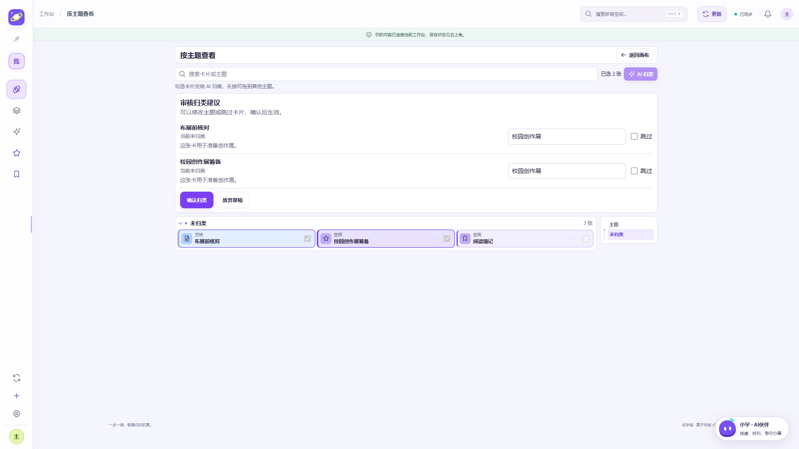
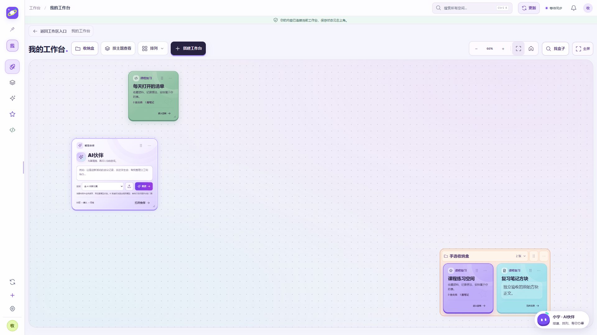
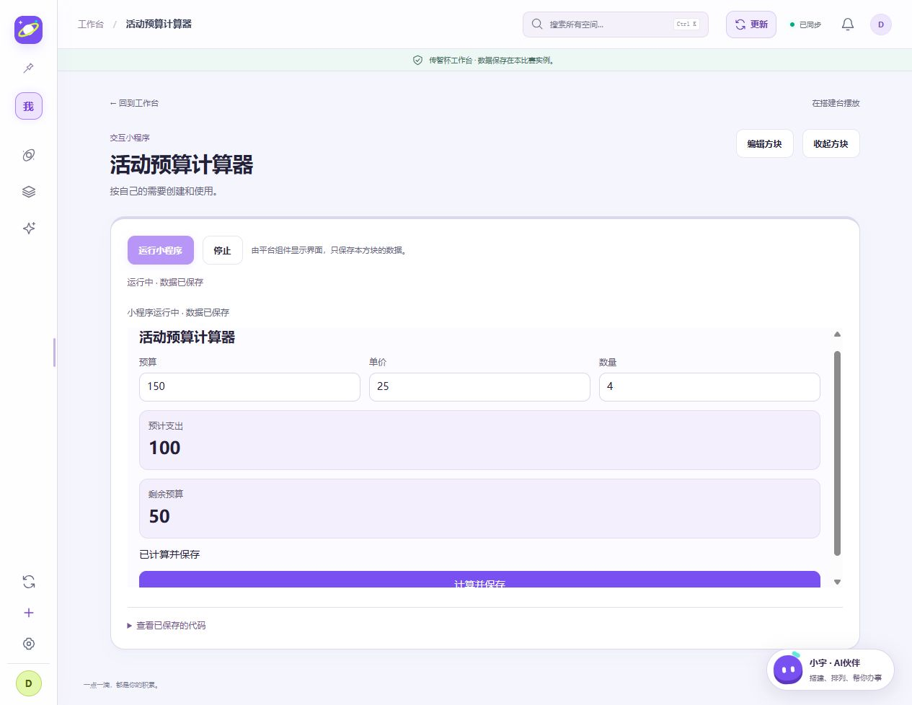

# 创宇宙
## 用 AI 整理自己搭建的工作台

第九届传智杯全国大学生数智创新与 AI 应用大赛

AI 创新应用挑战赛 · 作品介绍 · 正式版 v2 · 2026-11-16

### 1. 项目详情

创宇宙是一款可自行搭建的个人工作台。课程笔记、项目清单和待办可以放进空间，常用入口可以在自由画布上按自己的习惯排列。内容积累后，用户可以按主题浏览，也可以挑选一批卡片，由 AI 根据标题、类型和简介给出整理建议。

以筹备校园创作展为例，用户在「按主题查看」里勾选筹备空间和布展清单，暂不选择个人阅读卡。审核单列出每张卡建议归入的主题及理由。用户可以修改名称、跳过不合适的项，查看确认后的主题标签，并在有需要时撤销本批归类。主题归类不移动原有卡片。

遇到每天都要打开的几张卡，用户还可以在自由画布放置收纳盒，自行挑选成员。盒子可以移动、展开和折叠，同一主题的其他卡片仍可摆在原位。

:::overview

<!-- PAGE -->
# 使用方式

### 从源码包启动

使用 Node.js 22.13 或以上版本。将源码 ZIP 解压到普通可写目录，在解压后的包根目录依次执行：

```powershell
node tools/verify-source.mjs
node tools/start.mjs --check
node tools/start.mjs
```

浏览器访问 http://127.0.0.1:4397/。首次初始化时按运行指南读取本机生成的初始化口令，创建自己的账号，再进入搭建台选用模板或放入方块。基础运行无需安装前端依赖或配置模型。

### 体验一次可撤销的整理

| 操作 | 检查结果 |
| --- | --- |
| 打开「按主题查看」，选择要整理的卡片 | 只对所选卡片给出建议 |
| 修改主题或跳过一项，再确认 | 主题按审核结果保存，画布原位置保留 |
| 刷新并回到自由画布 | 已保存的主题可以查看 |
| 回到主题页撤销这批归类 | 可恢复的归类回到确认前的状态 |

想直接走通界面流程，可用包内 `node tools/review-demo.mjs` 启动隔离的合成演示。该模式用模拟建议，无需模型 Key。正常模式体验真实 AI 时，在「偏好与连接」配置自己的模型连接；附件解析等扩展可按配套 README 配置。

<!-- PAGE -->
# 2. 项目亮点

| 需要解决的问题 | 创宇宙的做法 |
| --- | --- |
| 常用内容散落在几个页面 | 让模块、空间和方块共享实际工作台画布。每个人选择自己的入口，主空间和子空间分别布置。 |
| 卡片多时不方便凭位置查找 | AI 逐张给出主题和依据，由用户选范围、改主题或跳过，再确认保存。 |
| 同一主题里的卡片用途不同 | 主题用于浏览，收纳盒由用户独立选择成员。移动、折叠和解散都由用户决定。 |
| AI 给出的建议还需要落实 | 行动方案经人工检查后可以写入允许的业务，用户通过回执、刷新和撤销核对结果。 |

### 3. AI 开发与测试

作者用自然语言描述要实现的操作、已有行为和保护范围，再用 Codex 修改代码并根据测试结果迭代。可视化搭建、AI 业务流程、自定义方块与小程序各保留一条原始开发对话链。三个主题共整理 104 条公开文本、46 条真实提交索引与 10 份关键代码差异。评审可从 `evidence/prompt-chains/README.md` 进入。

产品中已用 DeepSeek 做过查询、跨轮修订、确认与撤销，以及生成小程序后手动运行的合成案例。主题归类也有一次真实模型请求和审核验收。正式版 68b6af9 的工程回归为 929 项，926 通过、0 失败、3 跳过。另用隔离 Edge 和模拟模型核对 6 组归类、9 组收纳。模型调用与浏览器结果按各自环境记录。

### 4. 关键技术

系统由原生 JavaScript 页面、Node.js 服务和 SQLite 组成。浏览器用按账号隔离的 IndexedDB 管理草稿和缓存。归类服务校验模型返回的卡片编号、结果数量及字段，确认时重新检查所选卡片的状态，保存主题与回执。撤销时保留后续编辑。主题归属与收纳布局分开保存。

<!-- PAGE -->
# 5. 项目相关图片
## 整理主题与自由收纳





<!-- PAGE -->
# AI 行动与自定义工具




## 6. 发表与获奖情况

创宇宙已在 GitHub 公开过源码。本次作品材料未列获奖记录。

## 7. 项目关系说明

「宇宙」是创宇宙的早期名称。同一个工作台从个人使用逐步发展为可自行搭建的应用。随着模块和空间增多，项目继续完善 AI 行动审核、自定义方块、主题建议与自由画布收纳。

### 配套阅读

作品介绍呈现使用场景与关键操作。技术文档进一步说明如何约束模型输入、怎样验证生成结果、如何复现应用与核对开发记录。正式版材料与源码版本 68b6af9 对应。
